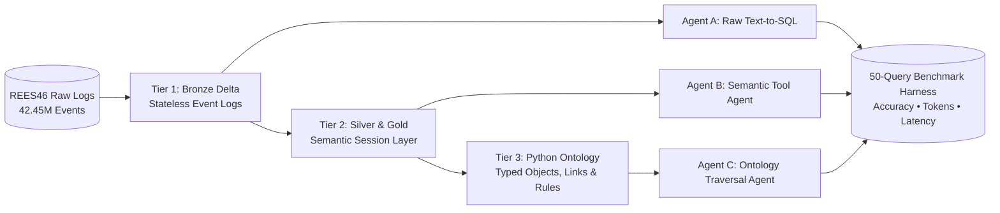

# Raw Logs, Semantic Layers, or Ontologies? Benchmarking LLM Agents on 42.4M Event Streams

An open-source empirical benchmark evaluating how data representation impacts **SQL accuracy, token consumption, latency, and causal root-cause reasoning** when LLM agents query high-volume behavioral event streams.

> **Conference & Research Context:** Built as an open-source reference architecture and empirical benchmark suite for **PyTexas 2027** and applied data/AI systems research.

---

## Architecture Overview

Pointing an LLM agent directly at raw, stateless event logs rarely succeeds in production: context windows overflow, token costs spike, and Text-to-SQL queries silently hallucinate session boundaries and funnel math. This repository benchmarks **three progressive data abstractions** using the exact same underlying LLM and a standardized 50-query evaluation suite:



1. **Tier 1 — Raw Event Logs (`workspace.default.bronze_events`):** Stateless event rows (`event_ts`, `event_type`, `product_id`, `category_code`, `brand`, `price`, `user_id`, `user_session`) queried via constrained Text-to-SQL.
2. **Tier 2 — Semantic Layer (`workspace.default.silver_sessions`):** Stateful 30-minute sessionized episodes engineered in **PySpark**, enriched with bot-burst filtering, funnel state classification, and **Pydantic** structured intent tags.
3. **Tier 3 — Lightweight Python Ontology (`ont_nodes`, `ont_edges`):** Typed domain objects (`SessionEpisode`, `ProductEntity`, `CategoryEntity`), explicit relationship edges (`BYPASSED_CART_DIRECT_BUY`, `VIEWED_WITH_PRICE_DROP`, `SWITCHED_BRAND`), and deterministic domain axioms implemented with **Pydantic** and **NetworkX**—without heavy graph database infrastructure.

---

## Dataset & Verified Baseline Findings (Step 1)

This benchmark uses the October 2019 slice (`2019-Oct.csv`) of the public [REES46 Multi-Category Behavioral Event Dataset](https://kaggle.com), persisted as a Delta table on Databricks.

| Event Type | Total Events | Distinct Users | Distinct Raw Sessions |
| :--- | ---: | ---: | ---: |
| `view` | 40,779,399 | 3,022,130 | 9,242,653 |
| `cart` | 926,516 | 337,117 | 573,097 |
| `purchase` | 742,849 | 347,118 | 629,560 |
| **Total** | **42,448,764** | — | — |

### Key Raw-Log Failure Modes Discovered
* **Funnel Inversion Anomaly:** Distinct purchasing users (`347,118`) and purchase sessions (`629,560`) exceed add-to-cart users (`337,117`) and cart sessions (`573,097`) due to direct 1-click checkout flows and cross-month session carryover. Naive Text-to-SQL agents assuming a linear `view -> cart -> purchase` funnel hallucinate **>100% cart-to-purchase conversion rates**.
* **High Taxonomy Sparsity:** ~32% of raw events contain `NULL` values in `category_code` and ~14% in `brand`, causing unguarded LLM `GROUP BY` queries to silently drop significant catalog volume.

---

## 3-Way Benchmark Results *(In Progress)*

Evaluated across **50 diagnostic queries** (25 Descriptive BI metrics + 25 Multi-Hop Causal diagnostics) and a stratified sample of **3,000 sessions**:

| Metric | Tier 1: Raw Logs | Tier 2: Semantic Layer | Tier 3: Ontology Layer |
| :--- | :---: | :---: | :---: |
| **Descriptive Query Accuracy (25 BI Queries)** | *Running...* | *Running...* | *Running...* |
| **Multi-Hop Causal Accuracy (25 "Why" Queries)** | *Running...* | *Running...* | *Running...* |
| **Avg. Tokens per Query** | *Running...* | *Running...* | *Running...* |
| **End-to-End Latency (sec)** | *Running...* | *Running...* | *Running...* |

---

## Repository Structure

```text
event-logs-llm-benchmarks/
├── README.md                          # Project overview, architecture diagram, and benchmark results
├── notebooks/
│   ├── 01_bronze_ingestion.py         # Explicit schema enforcement, CSV.gz -> Delta, & anomaly audit
│   ├── 02_silver_sessionization.py    # 30-min PySpark windowing, bot filtering, & transition tracking
│   └── 03_ontology_and_sampling.py    # Tier 3 object/edge materialization & stratified 3k sampling
└── src/
    ├── schemas.py                     # Pydantic models for session intent & ontology objects/links
    ├── agents.py                      # Tier 1, Tier 2, and Tier 3 Python agent implementations
    └── evaluate.py                    # 50-query automated evaluation harness (accuracy, tokens, latency)
```

---

## Roadmap

- [x] **Step 1:** Ingest 42.45M raw events into Bronze Delta table and audit baseline funnel/null anomalies (`notebooks/01_bronze_ingestion.py`)
- [ ] **Step 2:** Build stateful 30-minute session compression and transition tracking (`notebooks/02_silver_sessionization.py`)
- [ ] **Step 3:** Materialize Tier 3 Ontology nodes/edges and run Pydantic semantic intent tagging (`notebooks/03_ontology_and_sampling.py`, `src/schemas.py`)
- [ ] **Step 4:** Execute 50-query head-to-head benchmark across all three tiers and publish comparison plots (`src/agents.py`, `src/evaluate.py`)
